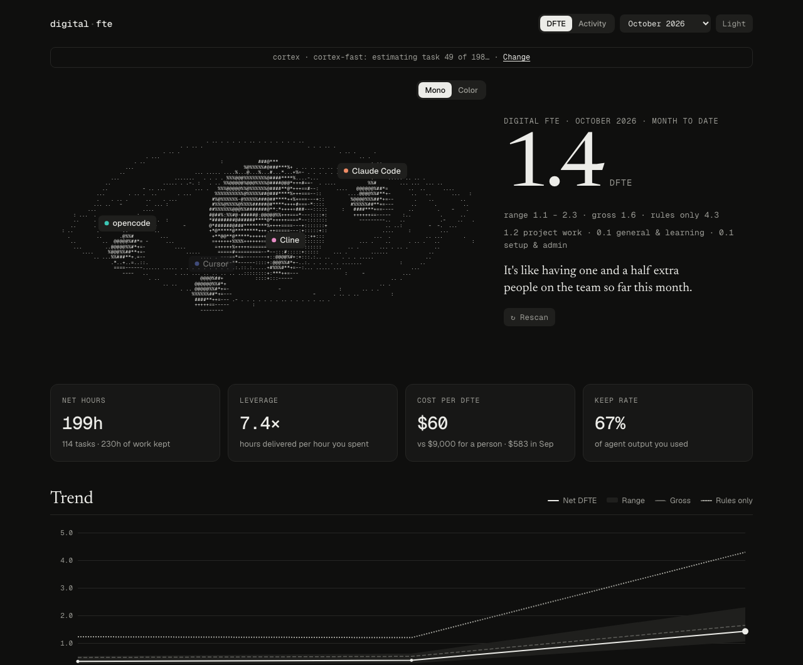
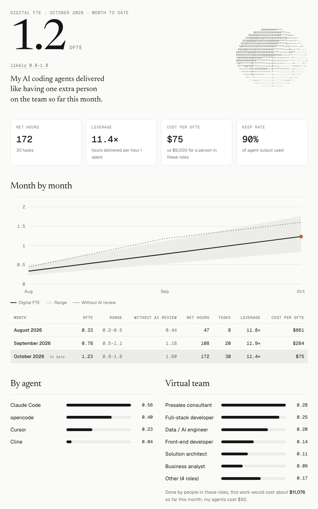
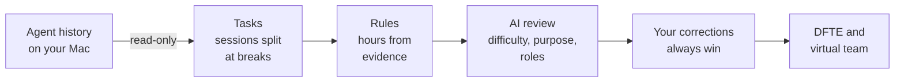

# Digital FTE

**How many full-time people's worth of work do your AI coding agents do for you,
and which jobs are they doing?**

Digital FTE reads the history your coding agents already keep on your Mac
(Claude Code, opencode, Cursor and Cline), works out how long each piece of work
would have taken a person without AI, and turns it into one number per month:
**Digital Full-Time Equivalents (DFTE)**. It also shows the **virtual team** the
work adds up to, and what that team would cost.

> "My agents delivered **1.2 DFTE** this month: like one extra person, working as
> a presales consultant, a full-stack developer and a data engineer, for **$92**
> of subscriptions."

Everything runs on your Mac. Your transcripts never leave it.


*Screenshots use made-up sample data.*

---

## What you get

- **One headline number:** your Digital FTE for the month, with a likely range.
- **A virtual team:** the job roles the work needed, e.g. *0.3 presales
  consultant, 0.25 full-stack developer, 0.2 data / AI engineer*, what people in
  those roles would cost, and how the mix changes month by month.
- **Proof behind it:** every task is listed with the evidence its estimate came
  from (lines written, files read, commands run) and the AI's one-sentence
  reason. Click any task to correct it; the app learns from your corrections.
- **Breakdowns and trends:** by agent, by project, by category, with leverage
  (hours delivered per hour you spent), cost per DFTE and keep rate.
- **A daily refresh** that catches up by itself, even if your laptop was closed.
- **A summary page to share** with your manager: totals and the virtual team
  only, no task, project or customer names.

<p>
  
  
</p>

*Left: the dashboard in dark mode. Right: the summary page you can share.*

---

## How it works



For every task, **net hours = H × K − Y**: the hours a person would need without
AI (H), times the share of the output you kept (K), minus your own time
prompting and reviewing (Y). **DFTE = the month's net hours ÷ 140**, the
productive hours in one person's month.

**[Read how it works →](docs/how-it-works.md)** the calculation with a worked
example, the three kinds of work, the virtual team, how the app learns, guard
rails and known limits.

---

## Quick start

On a Mac with Python 3.12+ and at least one of the agents installed:

```bash
git clone https://github.com/amrsingh29/digital-fte.git ~/Developer/digital-fte
cd ~/Developer/digital-fte
python3 -m venv .venv
.venv/bin/pip install -e ".[claude]"
.venv/bin/fte scan
.venv/bin/fte serve
```

Then open **http://127.0.0.1:8770**. The repository is private; ask the owner
for access first.

**[Full setup guide →](docs/setup-mac.md)** checking your costs, choosing an AI
service (with your key in the macOS Keychain), the daily refresh, updating and
uninstalling.

---

## Using it day to day

**Two views**, switched at the top: **DFTE** (the number, its breakdowns and
your tasks) and **Activity** (raw sessions: prompts, actions, lines, active time).
**Color / Mono** switches the colours, and the month picker is next to it.

- **Click an agent** in the orbit, or in By agent, to filter the whole page.
- **Pick a month** at the top, or click a month on the Trend or Virtual team chart.
- **Filter the tasks** by purpose (chips), by day and by category, or click a bar
  in By category.
- **Click a task** to see why it got its estimate, and correct it: its size (XS
  to Month), keep factor, purpose, category and roles. A note in the editor says
  which changes guide the AI on future tasks.
- **↻ Rescan** reads new history straight away.
- **↗ Share summary** opens the one-page summary for your manager, ready to save
  or send. `fte share --name YourName` writes it to a file instead.
- **Settings** (at the bottom) holds the agent switches, the active AI service
  and the refresh schedule.

**[Reviewing and correcting tasks →](docs/reviewing-tasks.md)** every option in
the task editor, how the app learns from you, and a 10-minute weekly routine.

---

## Privacy: what stays on your Mac

| | Where it goes |
|---|---|
| Agent history files | Read only, never changed or moved |
| Prompts, replies, file names | Copied into `~/.digital-fte/fte.db` on your Mac, first 4,000 characters of each message |
| The dashboard | Runs at `127.0.0.1`: only your Mac can open it |
| **Sent to the AI service you choose** | A short summary per task: up to three prompt excerpts (300 characters each), edited file names, counts, an excerpt of the final reply (400 characters), plus the titles and labels of up to 10 tasks you corrected, as examples. Never the full transcript. Use a local model or turn AI off to send nothing. |
| API keys | Read from the macOS Keychain or an environment variable. Never written to a file. |
| The summary page | Totals and role names only. Nothing leaves your Mac unless you send it yourself. |

---

## Documentation

| Guide | For |
|---|---|
| [Setup on a Mac](docs/setup-mac.md) | Installing, AI service and keys, daily refresh, updating, uninstalling |
| [How it works](docs/how-it-works.md) | The calculation, purposes, the virtual team, learning, guard rails, limits |
| [Reviewing and correcting tasks](docs/reviewing-tasks.md) | The task editor, sizes, roles, filters, and a weekly routine |
| [Configuration](docs/configuration.md) | Every setting, the role catalog and costs, commands, troubleshooting |
| [Changelog](CHANGELOG.md) | What changed in each release |

---

## For developers

**Stack:** Python 3.12+, FastAPI, SQLite, plain JavaScript with ECharts. The
ASCII orbit is drawn on a canvas, character by character, with no library.

```
src/digital_fte/
  collectors/      one reader per agent (Claude Code, opencode, Cursor, Cline)
  scan.py          reads agent history into ~/.digital-fte/fte.db
  estimate.py      splits sessions into tasks; rules for H, K, Y and purpose
  ai.py            AI connectors (OpenAI-compatible, Anthropic), prompts, examples from your corrections
  refine.py        final numbers: rules → AI → guard rails → learning → your corrections; roles
  jobs.py          daily refresh (launchd) and cross-process locks
  share.py         the totals-only summary page
  app.py           the dashboard server and its API
  static/, templates/   the dashboard
scripts/
  sample_data.py   made-up data for screenshots and demos
tests/             tests for every reader and every rule
```

```bash
.venv/bin/pip install -e ".[dev,claude]"
.venv/bin/python -m pytest
.venv/bin/fte serve --reload
```

### Try it with sample data

See the app with three months of made-up tasks, without touching your own data:

```bash
.venv/bin/python scripts/sample_data.py /tmp/dfte-sample --serve
```

Then open **http://127.0.0.1:8766**. It never scans your history and never calls
an AI service. The README screenshots come from it.

**Licence:** [MIT](LICENSE).

**Adding an agent:** write a reader in `collectors/` that turns its history into
sessions of prompts, replies and actions (see `collectors/base.py`), and add one
line to `collectors/__init__.py`. The rest of the app works with it unchanged.
