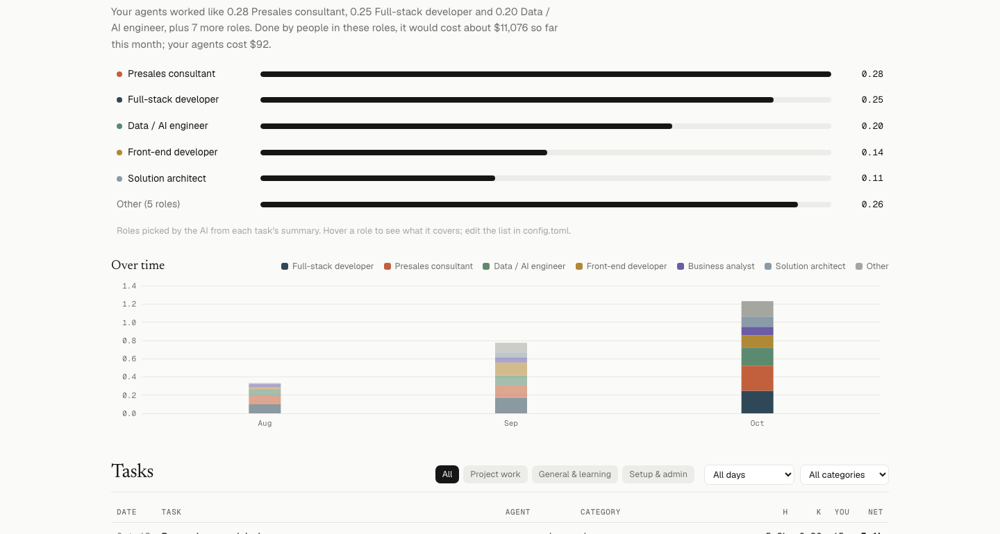
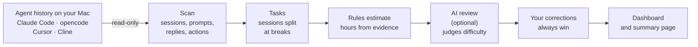

# Digital FTE

**How many full-time people's worth of work do your AI coding agents do for you?**

Digital FTE reads the history your coding agents already keep on your Mac
(Claude Code, opencode, Cursor and Cline), works out how long each piece of work
would have taken a person without AI, and turns it into one number per month:
**Digital Full-Time Equivalents (DFTE)**.

> "My agents delivered **1.4 DFTE** this month: like having one and a half extra
> people on the team, at **$60** per DFTE against **$9,000** for a person."

Everything runs on your Mac. Your transcripts never leave it.



---

## Contents

1. [What you get](#what-you-get)
2. [How it works](#how-it-works)
3. [How the number is calculated](#how-the-number-is-calculated)
4. [Setup on a Mac](#setup-on-a-mac)
5. [Using it day to day](#using-it-day-to-day)
6. [Privacy: what stays on your Mac](#privacy-what-stays-on-your-mac)
7. [Settings](#settings)
8. [Commands](#commands)
9. [Troubleshooting](#troubleshooting)
10. [For developers](#for-developers)

---

## What you get

- **One headline number:** your Digital FTE for the month, with a low–high range
  and the split between project work, general learning, and setup & admin.
- **Proof behind it:** every task is listed with the evidence its estimate came
  from (lines written, files read, commands run) and, when AI is on, a
  one-sentence reason. Click any task to correct it.
- **A virtual team:** which job roles the work replaced, e.g. *1.1 full-stack
  developer, 0.4 presales consultant, 0.2 business analyst*.
- **Trends:** DFTE, leverage (hours delivered per hour you spent), cost per DFTE
  and keep rate, month by month, by agent and by project.
- **A daily refresh** that catches up by itself, even if your laptop was closed.
- **A summary page to share** with your manager: totals only, no task, project or
  customer names.

<p>
  
  
</p>

*Left: the dashboard in dark mode. Right: the summary page you can share.*

---

## How it works



1. **Scan.** The app reads each agent's history files *read-only* and copies the
   useful parts into its own small database in `~/.digital-fte/`. Only changed
   sessions are re-read, so a scan takes a second or two.
2. **Split into tasks.** A long session usually covers several pieces of work. A
   new task starts when you prompt again after a break of more than 30 minutes.
   Work done by subagents counts toward the task that started it.
3. **Estimate with rules.** For each task, the app counts the evidence (lines of
   code and documents written, files read, commands run, web lookups, words of
   answers) and converts it to the hours a competent person would need.
4. **Review with AI (optional).** Rules count volume, not difficulty. An AI
   service of your choice reads a short summary of each task and judges how hard
   it really was: 1,000 lines of generated sample data is quick for a person to
   produce; a three-line fix to a tricky bug can take hours. It also names the
   task and decides its purpose.
5. **Your corrections win.** Click any task to change its hours, keep factor,
   category or purpose. After three corrections in a category, the app applies
   your pattern to the rest of that category
   ([how to review](docs/reviewing-tasks.md)).
6. **Show it.** The dashboard adds everything up per month.

---

## How the number is calculated

For every task:

```
Net hours  =  H × K  −  Y
```

| | Means | Where it comes from |
|---|---|---|
| **H** | Hours a competent person would need without AI | Rules from the evidence, then reviewed by AI |
| **K** | Keep factor: how much of the output you actually used (0 to 1) | 1.0 if the edited files are in git, 0.9 if still on disk, 0.3 if deleted; 0.7 when there's nothing to check |
| **Y** | Your own time: writing prompts and reviewing replies | From the transcript timestamps |

For every month:

```
DFTE  =  total net hours  ÷  140
```

140 is the productive hours in one person's month (20 days × 7 hours). You can
change it.

### A worked example

You asked Cursor to generate a set of process definitions.

| Step | Value |
|---|---|
| Evidence | 2,843 lines of code, 240 files read, 34 commands |
| H from rules (lines ÷ 50 per hour, plus reading and command time) | 87 hours |
| H after AI review: *"Most of the lines are templated boilerplate; the real effort is reading the spec, building the set and fixing the tricky errors."* | **22 hours** |
| K: most edited files still on disk, a few deleted | 0.78 |
| Y: your prompts and review time | 0.6 hours |
| **Net hours** = 22 × 0.78 − 0.6 | **16.6 hours** |

Add up every task in October, divide by 140, and you have October's DFTE.

### Three kinds of work

Each task gets a **purpose**, so everyday questions don't need a project:

| Purpose | Examples | Counts toward DFTE |
|---|---|---|
| **Project work** | a customer deck, a proof of concept, a new feature | fully |
| **General & learning** | "how do vector databases work?", explaining a concept, comparing tools | fully, by default: the AI is doing what a senior colleague or teacher would |
| **Setup & admin** | configuring agents, fixing your shell, installing tools | fully, by default |

You can make learning or admin count half, or not at all, in the settings.

### The virtual team

DFTE says **how much** work the agents did. The **Virtual team** card says **what
kind**: the job roles the same work would have needed.

- Each task gets **one or two roles** from a catalog, with a share of its hours
  (e.g. 60% presales consultant, 40% full-stack developer). A role's DFTE is the
  sum of its shares of net hours ÷ 140.
- **The AI picks the roles**, judging by *why* the work was done, not just the
  file types. A Python script built for a customer demo is mostly presales work.
  It can only choose roles from your catalog.
- **Until the AI has reviewed a task**, it gets a first guess from its category
  or purpose: code → full-stack developer, documents and demos → presales
  consultant, analysis → business analyst, learning → researcher / advisor,
  setup → DevOps / IT admin.
- **Roles never change the hours.** They only label (and later, value) them.

The default catalog has 10 roles: full-stack developer, front-end developer,
data / AI engineer, DevOps / IT admin, UX designer, technical writer, business
analyst, solution architect, presales consultant, researcher / advisor. Edit it
in `config.toml` to fit your work (see [Settings](#settings)).

### Other numbers on the dashboard

Hover over (or tap) any number on the dashboard to see its definition.

| Number | Meaning |
|---|---|
| **Range** | DFTE using the low and high estimate of every task |
| **Rules only** | DFTE before AI review, for comparison |
| **Gross** | DFTE without subtracting your own time |
| **Leverage** | Hours of work delivered for every hour you spent |
| **Cost per DFTE** | What your agents cost per month ÷ DFTE. The current month counts only the days so far. |
| **Keep rate** | Share of the agents' output you actually used |

### Guard rails

- The AI's hours must stay between a quarter and double the rules estimate, so
  one odd answer can't swing the total.
- One huge generated file counts as at most 300 lines.
- Only the AI service you choose is used, and only short summaries are sent.

### Known limits

- **Your own time (Y) is undercounted.** Thinking, testing and checking output
  outside the chat isn't in the transcripts, so leverage looks better than it is.
- **The AI's judgement depends on the model.** Correct a few tasks so the app
  learns your view.
- **Cursor doesn't record token counts**, so its activity figures are less
  complete. Its DFTE is not affected.

---

## Setup on a Mac

About 10 minutes. You need macOS, Python 3.12 or newer, and at least one of
Claude Code, opencode, Cursor (agent chats) or Cline installed and used.

### 1. Check Python and git

```bash
python3 --version
```

If it says 3.12 or higher, you're set. Otherwise install Python with
[Homebrew](https://brew.sh):

```bash
brew install python
```

If `git` isn't installed, macOS offers to install the command line tools the
first time you run it. You can also start that yourself:

```bash
xcode-select --install
```

### 2. Get the code

```bash
git clone https://github.com/amrsingh29/digital-fte.git ~/Developer/digital-fte
```

The repository is private; ask the owner for access first.

### 3. Install

```bash
cd ~/Developer/digital-fte
python3 -m venv .venv
.venv/bin/pip install -e ".[claude]"
```

`[claude]` adds the Anthropic SDK for the Claude connector. Leave it off
(`pip install -e .`) if you won't use Claude.

### 4. Run the first scan

```bash
.venv/bin/fte scan
```

This creates your settings file at `~/.digital-fte/config.toml` and shows which
agents it found:

```
claude_code  on   78 sessions, 78 re-read
opencode     on   28 sessions, 28 re-read
cursor       on   18 sessions, 18 re-read
cline        on   4 sessions, 4 re-read
```

An agent you don't use shows `not found`. That's fine.

### 5. Check your numbers

Open the settings file:

```bash
open -t ~/.digital-fte/config.toml
```

Before trusting the numbers, set these four:

| Setting | Where | Why |
|---|---|---|
| `cost_per_month` | under each `[agents.…]` | What you pay for each agent. Use 0 if your company pays and you don't know the cost. |
| `human_cost_per_month` | `[dfte]` | Monthly cost of a person in your role, for the cost comparison |
| `hours_per_fte_month` | `[dfte]` | Productive hours in a month where you work (140 by default) |
| `enabled` | under each `[agents.…]` | Turn off agents you don't want counted |

### 6. Choose an AI service (optional, recommended)

Without AI the app uses rules only, which overestimate code-heavy work. To turn
on AI review, store your API key in the macOS Keychain (the command asks for it,
so it never appears on screen or in your shell history), then select the service.

**Claude (Anthropic):**

```bash
security add-generic-password -a "$USER" -s anthropic-api-key -w
```

Then, in `config.toml`:

```toml
[ai]
use = "claude"

[ai.claude]
key_keychain = "anthropic-api-key"
```

**OpenAI or Gemini:** the same steps, with service names such as
`openai-api-key` or `gemini-api-key`. Also set `model` under `[ai.openai]` or
`[ai.gemini]` to the model you want to use.

**Your company's own endpoint** (any OpenAI-compatible service, such as Cortex):
set its `base_url`, `model` and `key_keychain` under `[ai.cortex]`, or add a new
`[ai.<name>]` block with `api = "openai"`.

**A local model** with [Ollama](https://ollama.com): set `model` under
`[ai.local]` and `use = "local"`. No key needed, and nothing leaves your Mac.

**No AI:** `use = "off"`.

### 7. Start the dashboard

```bash
.venv/bin/fte serve
```

Open **http://127.0.0.1:8765** in your browser. The first time, the AI step
estimates all your existing tasks in the background; the banner shows its
progress.

### 8. Turn on the daily refresh

```bash
.venv/bin/fte schedule install --at 20:00
```

| At refresh time your Mac is… | What happens |
|---|---|
| on | it runs at that time, at low priority |
| asleep (lid closed) | it runs as soon as the Mac wakes; several missed days count as one run |
| shut down | it runs when you log in |

Each run is skipped if the app already scanned in the last 2 hours (the
dashboard scans when it starts and when you click Rescan), so logging in several
times a day doesn't repeat it.

Missed days lose nothing. Agents keep their history, and the next run catches
up. Some agents delete old history (Claude Code removes transcripts after about
30 days by default), so the app keeps every session it has ever read.

### Run the refresh yourself

You don't have to wait for the scheduled time.

| To | Run |
|---|---|
| Refresh now (scan + AI estimates) | `.venv/bin/fte refresh` |
| Run the scheduled job now, exactly as macOS would | `launchctl kickstart -k gui/$(id -u)/local.digital-fte.refresh` |
| See whether the job is set up, and its last run | `.venv/bin/fte schedule status` |
| Follow the job's log | `tail -f ~/.digital-fte/refresh.log` |
| Change the time, e.g. to 6:30 pm | `.venv/bin/fte schedule install --at 18:30` |
| Stop the daily refresh | `.venv/bin/fte schedule remove` |

`fte refresh` always runs. The scheduled job skips itself if a scan happened in
the last 2 hours; to apply the same rule by hand, use
`fte refresh --if-older-than 2`. Clicking **Rescan** in the dashboard scans
straight away, and new tasks are then estimated in the background.

### 9. Optional: a shorter command

Add this line to `~/.zshrc`, then open a new terminal window. You can then type
`fte serve` from anywhere.

```bash
alias fte="$HOME/Developer/digital-fte/.venv/bin/fte"
```

### Updating

```bash
cd ~/Developer/digital-fte
git pull
.venv/bin/pip install -e ".[claude]"
```

Then restart `fte serve`. Your settings and data in `~/.digital-fte/` are kept.

### Uninstalling

```bash
.venv/bin/fte schedule remove
rm -rf ~/Developer/digital-fte
```

Your data and settings are in `~/.digital-fte/`. Delete that folder too if you
want them gone.

---

## Using it day to day

**The dashboard** has two views, switched at the top right:

- **DFTE:** the headline number, its split by purpose, the trend, breakdowns by
  agent and project, and the task list.
- **Activity:** raw sessions: prompts, agent actions, lines written, active time.

**Things you can do:**

- **Click an agent** in the orbit, or in "By agent", to filter the whole page.
- **Pick a month** at the top right, or click a point on the trend chart.
- **Click a task** to see why it got its estimate, and correct it: pick a size
  (XS to Month) or type the hours, and set the keep factor, category or purpose.
  You can also mark it *not real work*. **Reset to estimate** undoes your change.
  See **[Reviewing and correcting tasks](docs/reviewing-tasks.md)** for every
  option, how the app learns from your corrections, and a 10-minute weekly routine.
- **Rescan** reads new history straight away.
- **Settings** (at the bottom) holds the agent switches, the active AI service,
  the refresh schedule and the link to the summary page.

**Sharing with your manager.** Open *Settings → Share → Open the summary page*,
or run:

```bash
.venv/bin/fte share --name YourName
```

This writes `~/.digital-fte/summary.html`. The page shows monthly DFTE, hours,
leverage, cost and keep rate, split by agent and kind of work. It never includes
task names, prompts, files, or project and customer names.

---

## Privacy: what stays on your Mac

| | Where it goes |
|---|---|
| Agent history files | Read only, never changed or moved |
| Prompts, replies, file names | Copied into `~/.digital-fte/fte.db` on your Mac, first 4,000 characters of each message |
| The dashboard | Runs at `127.0.0.1`: only your Mac can open it |
| **Sent to the AI service you choose** | A short summary per task: up to three prompt excerpts (300 characters each), edited file names, counts, an excerpt of the final reply (400 characters). Never the full transcript. Use a local model or turn AI off to send nothing. |
| API keys | Read from the macOS Keychain or an environment variable. Never written to a file. |
| The summary page | Totals only. Nothing leaves your Mac unless you send the file yourself. |

---

## Settings

All settings live in `~/.digital-fte/config.toml`, created on the first scan.
Each line has a comment explaining it. The main ones:

| Section | Setting | Default | What it does |
|---|---|---|---|
| `[dfte]` | `hours_per_fte_month` | 140 | Productive hours in one person's month |
| | `human_cost_per_month` | 9000 | Monthly cost of a person, for cost comparison |
| | `default_keep` | 0.7 | Keep factor when the app can't check |
| | `review_cap_minutes` | 10 | Most review time counted before each follow-up prompt |
| | `exclude_paths` | [] | Folders whose sessions are never counted |
| `[agents.*]` | `enabled` | true | Count this agent |
| | `path` | per agent | Where the agent keeps its history |
| | `cost_per_month` | per agent | Its monthly cost |
| `[purposes]` | `learning_weight` | 1.0 | How much general & learning counts (0 to 1) |
| | `admin_weight` | 1.0 | How much setup & admin counts (0 to 1) |
| `[ai]` | `use` | cortex | Active AI service: cortex, claude, openai, gemini, local or off |
| | `auto` | true | Estimate new tasks automatically after each refresh |
| `[ai.*]` | `model`, `base_url`, `key_keychain`, `key_env` | per service | How to reach each AI service |
| | `parallel`, `pause_seconds` | 1, 3 for Cortex | Pace of AI requests, to leave room for your own agents |
| `[[roles]]` | `name`, `about` | 10 roles | The virtual team's role catalog. `about` tells the AI what a role covers |
| | `fallback` | per role | Categories or purposes that get this role before the AI has reviewed a task |
| | `monthly_cost` | `human_cost_per_month` | Monthly cost of this role (optional) |
| `[rates]` | 13 settings | | How evidence becomes hours (lines per hour, minutes per read, and so on) |

To add your own role, append it to the file and restart the dashboard. The AI
re-checks tasks only when they change, so assign the new role to older tasks
yourself, or ask the AI to pick roles again for every task with
`fte estimate --recheck-roles` (one AI request per task):

```toml
[[roles]]
name = "ITSM platform consultant"
about = "configures and extends ITSM and AIOps platforms for customers"
```

The agent switches and the active AI service can also be changed in the
dashboard under **Settings**.

---

## Commands

| Command | What it does |
|---|---|
| `fte serve` | Start the dashboard at http://127.0.0.1:8765 (rescans on start) |
| `fte scan` | Read new agent history. `--full` re-reads everything; `--agent cursor` reads one agent |
| `fte estimate` | Recompute tasks and print DFTE per month (rules vs final) |
| `fte estimate --ai` | The same, and send tasks the AI hasn't seen yet. `--limit N` for a few |
| `fte estimate --recheck-roles` | Ask the AI to pick roles again for every task, after you change the role catalog |
| `fte refresh` | Scan and AI estimates together: what the daily job runs |
| `fte schedule install --at HH:MM` | Turn on the daily refresh. Also `remove` and `status` |
| `fte share --name NAME` | Write the summary page to `~/.digital-fte/summary.html` |

Run them as `.venv/bin/fte …` from the project folder, or as `fte …` if you
added the alias.

---

## Troubleshooting

| Problem | What to do |
|---|---|
| An agent shows **not found** | Its history is somewhere else. Set its `path` in `config.toml`. |
| **"No key found in …"** in Settings → AI estimates | Store the key with `security add-generic-password` (step 6), check `key_keychain` matches the name you used, then reload the page after a minute. |
| **"Set a model in config.toml"** | Fill in `model` for that service. |
| AI estimates fail with **HTTP 429** | The service is busy. The app waits and retries. For a shared quota, raise `pause_seconds`. |
| AI estimates fail with **HTTP 403** | Check the key and `base_url`. Some company endpoints also need you to be on the company network or VPN. |
| **Address already in use** when starting | Another `fte serve` is running. Use it, or start on another port: `fte serve --port 8766`. |
| The daily refresh doesn't run | Run `fte schedule status`. If you moved the project folder, run `fte schedule install` again. The log is `~/.digital-fte/refresh.log`. |
| A new role isn't used for older tasks | Run `fte estimate --recheck-roles`. The AI only re-checks tasks that changed. |
| Numbers look too high | Turn on AI review (step 6), then correct a few tasks so the app learns your view. |
| Start over | Delete `~/.digital-fte/fte.db` and run `fte scan`. Settings are kept. |

---

## For developers

**Stack:** Python 3.12+, FastAPI, SQLite, plain JavaScript with ECharts. The
ASCII orbit is drawn on a canvas, character by character, with no library.

```
src/digital_fte/
  collectors/      one reader per agent (Claude Code, opencode, Cursor, Cline)
  scan.py          reads agent history into ~/.digital-fte/fte.db
  estimate.py      splits sessions into tasks; rules for H, K, Y and purpose
  ai.py            AI connectors (OpenAI-compatible, Anthropic), runs estimates
  refine.py        final numbers: rules → AI → guard rails → your corrections
  jobs.py          daily refresh (launchd) and cross-process locks
  share.py         the totals-only summary page
  app.py           the dashboard server and its API
  static/, templates/   the dashboard
tests/             tests for every reader and every rule
```

```bash
.venv/bin/pip install -e ".[dev,claude]"
.venv/bin/python -m pytest
.venv/bin/fte serve --reload
```

**Adding an agent:** write a reader in `collectors/` that turns its history into
sessions of prompts, replies and actions (see `collectors/base.py`), and add one
line to `collectors/__init__.py`. The rest of the app works with it unchanged.
