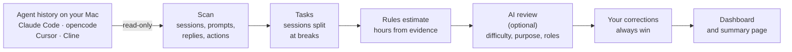
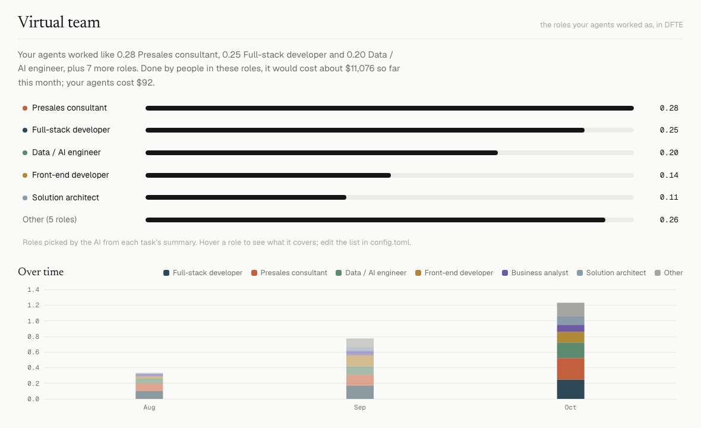

# How it works

[← Back to the README](../README.md)

How the app turns your agents' history into one number, a virtual team and a
cost comparison, and why each step is there.

1. [From history to tasks](#from-history-to-tasks)
2. [The calculation](#the-calculation)
3. [Three kinds of work](#three-kinds-of-work)
4. [The virtual team](#the-virtual-team)
5. [The numbers on the dashboard](#the-numbers-on-the-dashboard)
6. [How the app learns from you](#how-the-app-learns-from-you)
7. [Guard rails](#guard-rails)
8. [Known limits](#known-limits)

---

## From history to tasks



1. **Scan.** The app reads each agent's history files *read-only* and copies the
   useful parts into its own small database in `~/.digital-fte/`. Only changed
   sessions are re-read, so a scan takes a second or two. Sessions are kept even
   after an agent deletes its old history (Claude Code removes transcripts after
   about 30 days by default).
2. **Split into tasks.** A long session usually covers several pieces of work. A
   new task starts when you prompt again after a break of more than 30 minutes.
   Work done by subagents counts toward the task that started it.
3. **Estimate with rules.** For each task, the app counts the evidence (lines of
   code and documents written, files read, commands run, web lookups, words of
   answers) and converts it to the hours a competent person would need.
4. **Review with AI (optional).** Rules count volume, not difficulty. An AI
   service of your choice reads a short summary of each task and judges how hard
   it really was: 1,000 lines of generated sample data is quick for a person to
   produce; a three-line fix to a tricky bug can take hours. It also names the
   task, decides its purpose, and picks the job roles it needed.
5. **Your corrections win.** Click any task to change its hours, keep factor,
   purpose, category or roles. The app learns from them (see
   [below](#how-the-app-learns-from-you)).
6. **Show it.** The dashboard adds everything up per month.

---

## The calculation

For every task:

```
Net hours  =  H × K  −  Y
```

| | Means | Where it comes from |
|---|---|---|
| **H** | Hours a competent person would need without AI | Rules from the evidence, then reviewed by AI |
| **K** | Keep factor: how much of the output you actually used (0 to 1) | 1.0 if the edited files are in git, 0.9 if still on disk, 0.3 if deleted; 0.7 when there's nothing to check |
| **Y** | Your own time: writing prompts and reviewing replies | From the transcript timestamps |

For every month:

```
DFTE  =  total net hours  ÷  140
```

140 is the productive hours in one person's month (20 days × 7 hours). You can
change it.

### A worked example

You asked Cursor to generate a set of process definitions.

| Step | Value |
|---|---|
| Evidence | 2,843 lines of code, 240 files read, 34 commands |
| H from rules (lines ÷ 50 per hour, plus reading and command time) | 87 hours |
| H after AI review: *"Most of the lines are templated boilerplate; the real effort is reading the spec, building the set and fixing the tricky errors."* | **22 hours** |
| K: most edited files still on disk, a few deleted | 0.78 |
| Y: your prompts and review time | 0.6 hours |
| **Net hours** = 22 × 0.78 − 0.6 | **16.6 hours** |

Add up every task in October, divide by 140, and you have October's DFTE.

---

## Three kinds of work

Each task gets a **purpose**: *why* the work was done. Everyday questions don't
need a project.

| Purpose | Examples | Counts toward DFTE |
|---|---|---|
| **Project work** | a customer deck, a proof of concept, a new feature | fully |
| **General & learning** | "how do vector databases work?", explaining a concept, comparing tools | fully, by default: the AI is doing what a senior colleague or teacher would |
| **Setup & admin** | configuring agents, fixing your shell, installing tools | fully, by default |

You can make learning or admin count half, or not at all
([`[purposes]`](configuration.md#settings)). On the dashboard, learning and admin
appear below the divider in **By project**, and as filter chips on the task list.

Each task also has a **category**: *what kind* of work it was (code,
documentation, demo prep, research, analysis), shown in **By category**.

---

## The virtual team



DFTE says **how much** work the agents did. The **Virtual team** says **what
kind**: the job roles the same work would have needed, e.g. *0.3 presales
consultant, 0.25 full-stack developer and 0.2 data / AI engineer*.

- **One or two roles per task**, from a catalog, with a share of its hours
  (e.g. 70% presales consultant, 30% full-stack developer). A role's DFTE is the
  sum of its shares of net hours ÷ 140.
- **The AI picks the roles**, judging by *why* the work was done, not just the
  file types: a Python script built for a customer demo is mostly presales work.
  It can only choose roles from your catalog.
- **Before the AI has reviewed a task**, it gets a first guess from its purpose or
  category: code → full-stack developer, documents and demos → presales
  consultant, analysis → business analyst, research and learning → researcher /
  advisor, setup → DevOps / IT admin. The note under the card says how many tasks
  are still first guesses.
- **Roles never change the hours.** They only label and value them.
- **What the team would cost:** each role's DFTE × its `monthly_cost`, e.g.
  *"Done by people in these roles, it would cost about $11,076 so far this month;
  your agents cost $92."* **Cost per DFTE** is compared with the average cost of a
  person in the same roles.
- **Over time:** one stacked bar per month shows how the mix changes. The six
  biggest roles keep one colour everywhere; the rest are grouped as Other.
- **You can correct them** in the task editor: one role, or two with a 70/30,
  50/50 or 30/70 split ([how](reviewing-tasks.md#roles)).

The default catalog has 10 roles: full-stack developer, front-end developer,
data / AI engineer, DevOps / IT admin, UX designer, technical writer, business
analyst, solution architect, presales consultant and researcher / advisor. Add,
rename or remove roles, and set what each costs, in
[`config.toml`](configuration.md#roles-the-virtual-team).

---

## The numbers on the dashboard

Hover over (or tap) any number on the dashboard to see its definition.

| Number | Where | Meaning |
|---|---|---|
| **DFTE** | Headline | Net hours this month ÷ 140 |
| **Likely** | Under the headline | DFTE using the low and high estimate of every task |
| **Net hours** | Card | The month's net hours, and how many tasks |
| **Leverage** | Card | Hours of work delivered for every hour you spent |
| **Cost per DFTE** | Card | What your agents cost per month ÷ DFTE (the current month counts only the days so far), compared with a person in the same roles |
| **Keep rate** | Card | Share of the agents' output you actually used |
| **Before your own time** | Trend chart, dashed line | DFTE without subtracting your own time |
| **Without AI review** | Trend chart, dotted line | DFTE from the rules alone, so the effect of the AI review stays visible |

**Breakdowns:** By agent, By project (with learning and admin below the
divider), By category, and the Virtual team. Clicking an agent filters the
whole page; clicking a category filters the task list.

---

## How the app learns from you

Your corrections fix the tasks you touch, and also adjust the ones you don't, in
two separate ways:

| What you correct | How the app learns | Applies to |
|---|---|---|
| **Hours** | Arithmetic: after 3+ corrected tasks in a category, your typical ratio (e.g. code ×1.69) is applied to the rest of that category | All uncorrected tasks, straight away |
| **Roles, purpose, category** | By example: your 10 most recent corrections, taken in turn from each purpose, are shown to the AI when it judges a task | New tasks; older ones after `fte estimate --recheck-roles` |

Hours are never sent to the AI as examples, so it isn't nudged twice in the same
direction. Turn example learning off, or limit it, with `learn_from` in
[`config.toml`](configuration.md#settings). Details in
[Reviewing and correcting tasks](reviewing-tasks.md#how-the-app-learns).

---

## Guard rails

- The AI's hours must stay between a quarter and double the rules estimate, so
  one odd answer can't swing the total.
- One huge generated file counts as at most 300 lines.
- Only the AI service you choose is used, and only short summaries are sent
  ([privacy](../README.md#privacy-what-stays-on-your-mac)).
- Your corrections always win over the rules, the AI and anything learned.

---

## Known limits

- **Your own time (Y) is undercounted.** Thinking, testing and checking output
  outside the chat isn't in the transcripts, so leverage looks better than it is.
- **The AI's judgement depends on the model.** Correct a few tasks so the app
  learns your view.
- **Category and roles overlap.** Both describe the kind of work; a later version
  may merge them.
- **Cursor doesn't record token counts**, so its activity figures are less
  complete. Its DFTE is not affected.
