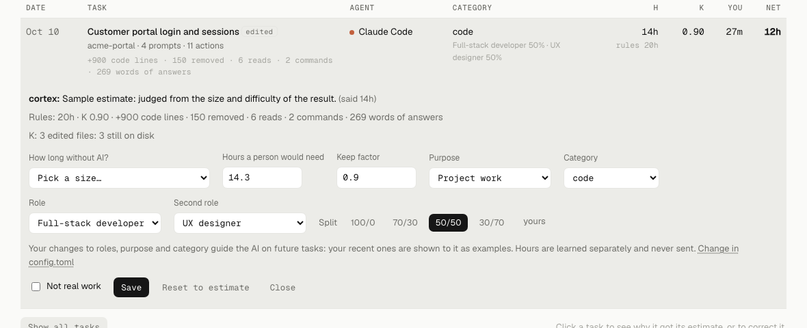

# Reviewing and correcting tasks

[← Back to the README](../README.md)

The Digital FTE number is only as good as each task's estimate. The app
estimates every task automatically, but **you know the work better than any
rule or AI model**. Ten minutes of review makes the number something you can
defend.

---

## Why review at all

The app estimates **H**, the hours a competent person would need without AI, in
two steps: rules count the evidence (lines written, files read, commands run),
then an AI service judges how hard the work really was. Both get some kinds of
work wrong in predictable ways. In a first review of 10 tasks:

| Kind of task | AI estimate compared with the owner's |
|---|---|
| Short notes, admin, small fixes | **too high**, about 2–3× |
| Half a day to a few days of work | **too low**, about 1.5–2× |
| A month-long build | **far too low**, about 5× |

Your corrections fix the tasks you touch, and the app **learns** from them to
adjust the ones you don't (see [How the app learns](#how-the-app-learns)).

---

## Opening a task

In the dashboard, go to the **DFTE** view and scroll to **Tasks**.

- **Click a task** to open its editor. Click it again, or **Close**, to fold it away.
- **Filter** with the chips above the list (*Project work*, *General & learning*,
  *Setup & admin*), the **day** and **category** lists next to them, a **month**
  at the top right, or click an **agent** to see only its tasks. Clicking a bar
  in **By category** filters the list to that category too; **Clear** removes the
  day and category filters.
- **Link to one task:** `http://127.0.0.1:8765/?task=<task id>` opens the page on
  that task with its editor open. **Show all tasks** goes back to the full list.

A task you've corrected shows an **edited** tag; one marked as not real work
shows **not counted** and is struck through.

---

## What the editor shows

From top to bottom:

| Part | What it tells you |
|---|---|
| **AI reason** (e.g. *cortex: …*) | The AI's one-sentence reason for its estimate. *(said 28h, kept within 0.25–2×…)* means its answer was outside the guard rails and was moved to the nearest limit. |
| **Rules** | The rules estimate, its keep factor, and the evidence it counted: lines of code and documents, lines removed, files read, commands, words of answers. |
| **K** | Why the keep factor has its value, e.g. *32 edited files: 29 in git, 1 still on disk, 2 gone*. If the app has learned a factor for this category, it says so here. |

---

## What you can change

### How long without AI? (sizes)

The quickest way to correct a task. Sizes are easier to judge than hours. Pick
the one that fits from the list; it fills in the hours for you. If you type
hours yourself, the list shows the matching size, or *Pick a size…* when none
matches.

| Size | Means | Hours |
|---|---|---|
| **XS** | under an hour | 0.5 |
| **S** | a couple of hours | 2 |
| **M** | half a day to a day | 6 |
| **L** | 2–3 days | 20 |
| **XL** | about a week | 35 |
| **XXL** | 2 weeks | 70 |
| **Month** | a month | 140 |

Ask yourself: *how long would a competent person need to produce this same
result without AI*, including understanding the problem, looking things up,
writing, testing and polishing?

### Hours a person would need

The same number the size list fills in. Type an exact value if you know it.

### Keep factor

How much of the output you actually used, from 0 to 1.

| Value | Use it when |
|---|---|
| **1** | You used it as it was, or built on it |
| **0.5** | You used about half, or had to redo a good part |
| **0** | You threw it away (the task then adds nothing) |

### Purpose

Why the work was done. It changes where the task is grouped and, if you've set
weights, how much it counts.

| Purpose | For |
|---|---|
| **Project work** | Something for a project, customer or product |
| **General & learning** | Asking the AI to explain or teach, as you would ask a senior colleague |
| **Setup & admin** | Configuring or fixing your own tools and machine |

### Category

What kind of work it was: code, documentation, demo prep, research or
analysis. It decides where the task appears in **By category**, which group the
app learns your hours from, and the task's first-guess role before the AI has
reviewed it.

### Roles

Which job roles the work needed: one, or two with a split of the hours. They
decide where the task's hours go in the **Virtual team** card. Roles never change
the hours themselves.

- **Role:** pick from your catalog (the 10 defaults, or your own in `config.toml`).
- **+ Add a second role** when part of the work needed different expertise, then
  pick a **split**: 70/30, 50/50 or 30/70 (first role / second role). **100/0**
  removes the second role again.
- The note next to the roles says where they came from: **AI's pick**, **first
  guess from the category** (the AI hasn't reviewed the task yet) or **yours**.

Example: the AI tagged *"Demo dashboard for customer meeting"* as full-stack
developer because it saw Python files. You know it was demo work, so you set
**Presales consultant** + **Full-stack developer** at **70/30**.

### Not real work

Tick it for things that shouldn't count at all: a test run, a question you
abandoned, chit-chat. The task stays in the list but adds nothing.

### Save, Reset to estimate, Close

- **Save** keeps your changes. A short *Saved* tag appears on the task; it says
  *Saved · will guide the AI on new tasks* when you changed its purpose,
  category or roles (see [How the app learns](#how-the-app-learns)). The editor
  also says this, under the roles, before you save. The headline, charts and totals update at once.
- **Reset to estimate** removes your correction and goes back to the AI's (or the
  rules') estimate. It only appears on edited tasks.
- **Close** folds the editor without saving.

Only the fields you actually change are saved as your correction. The rest keep
following the app's estimate.

---

## How the app learns

The app learns from your corrections in two separate ways.

### Hours: by arithmetic

Once you've corrected the hours on **3 or more tasks in the same category**, the
app works out your typical adjustment for that category and applies it to every
task in it that you haven't corrected.

- Example: after your code corrections, code tasks were on average 1.67× the AI's
  estimate, so the app now multiplies other code tasks by 1.67.
- The banner shows what it has learned, e.g. *learned: code ×1.67*, and the
  editor of an affected task says *learned factor ×1.67 for code*.
- The adjustment is kept between ×0.33 and ×3, so a few unusual corrections
  can't swing everything.
- Your own corrections always win over the learned factor.

### Roles, purpose and category: by example

Your recent corrections of **roles, purpose and category** are shown to the AI
as examples each time it judges a new task, like giving a new colleague a few
worked examples:

> *This person corrected these tasks before:*
> *"Demo dashboard for customer meeting" → project work · demo prep · 70% Presales consultant, 30% Full-stack developer*

A new task like *"Chart page for the customer demo"* then gets the same treatment
without you touching it.

- Up to **10 examples**, taken in turn from project work, learning and admin, so
  one busy week of one kind doesn't crowd out the rest.
- **Hours are never sent as examples.** They're learned by the arithmetic above,
  so the AI isn't nudged twice in the same direction.
- Tasks marked **Not real work** aren't used, and a task never sees its own
  correction.
- Examples affect **new tasks**. To re-judge older ones, run
  `fte estimate --recheck-roles`.
- It's a nudge, not a rule: the AI follows your examples only where the work is
  similar. Correct any it still gets wrong; that becomes an example too.
- To turn it off, or limit it, edit `learn_from` in `~/.digital-fte/config.toml`
  (`learn_from = []` turns it off).

---

## Big projects that span several tasks

A long piece of work, like building an app over a few weeks, is often split into
several tasks (a new task starts after a break of more than 30 minutes). It's
easier to judge the whole project than each part.

For now:

1. Filter to the project (it's named in each task's second line).
2. Put the whole size, e.g. **Month**, on the main *Project work* task, or share
   it across the project-work tasks by how big each is.
3. Leave small questions inside the project (*General & learning*) with their
   own small estimate.

A button to estimate a whole project at once is planned.

---

## A 10-minute weekly routine

1. Open the **DFTE** view for the current month.
2. Correct the **5 biggest tasks** by net hours: these move the number most.
3. Correct **3 small ones** at random: the AI tends to overestimate small tasks.
4. Check **purposes and roles**: is a general question filed as project work? Is
   demo work tagged as pure development?
5. Tick **Not real work** on anything that shouldn't count.

After two or three weeks the learned factors settle, and you'll mostly only need
to check the biggest tasks.

---

## Good to know

- Corrections are saved in `~/.digital-fte/fte.db` and survive rescans and
  restarts. A task keeps the same identity across rebuilds, so your correction
  stays attached.
- Corrections never leave your Mac. The shared summary page shows only totals,
  and says how many tasks you reviewed.
- Rules and AI estimates are kept alongside your corrections. The trend chart's
  dotted *Without AI review* line shows the rules estimate, so the effect of the review is always visible.
